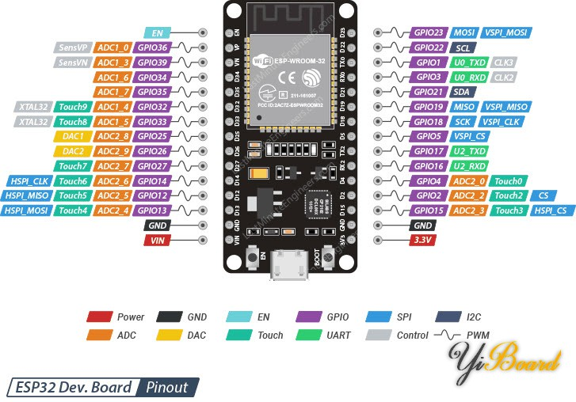

# ESP32-WROOM-32 / CH340 核心开发板

本次资料目录标识为 **ESP32-WROOM-32、Type-C、CH340**，提供的是常见30针开发板引脚图与模块资料。实际串口识别为 CH340（USB VID:PID `1A86:7523`），路径 `/dev/ttyUSB0`；实际芯片为 **ESP32-D0WD-V3，revision v3.1**，晶振40MHz。路径可能随插拔变化。

工程使用 `ESP32_DEVKIT` 配置：目标 `esp32`、默认4MB Flash、DIO、40MHz、UART0日志，不配置摄像头或SD卡。供应商教程第5页建议 ESP32 Dev Module、4MB、DIO，与当前固件配置一致。其他应用/组件在此芯片上的组合仍需分别验证。

## 原始资料

从上传的 `乐鑫esp32-wroom-32开发板焊针下C口ch340/ESP32开发板资料` 中收录以下4份唯一资料，文件内容已校验一致：

| 文件 | 用途与范围 |
| --- | --- |
| [30针开发板引脚图](ESP32-DevKit-pinout.jpg) | 对照排针位置、GPIO编号和常见复用功能 |
| [开发板使用教程](ESP32-board-user-guide.pdf) | 12页，Arduino环境和下载参数参考；其中混有ESP8266示例，本工程仍使用ESP-IDF |
| [ESP32管脚清单 V2.0](ESP32-pin-list-v2.0.pdf) | 2016年7月，9页，芯片IO复用、GPIO Matrix和启动绑带参考 |
| [ESP-WROOM-32数据手册 V1.3](ESP32-WROOM-32-datasheet-cn-v1.3.pdf) | 2016年12月，23页，模块38个焊盘的定义及模块电路参考 |

原目录中有两份内容相同的管脚清单，此处只收录一份。通用引脚图绘制的是 Micro-USB 外观，不能据此当作本块 Type-C / CH340 PCB 的精确原理图。模块数据手册中的38个焊盘编号也不是开发板30针排针编号；接线使用GPIO号和实物丝印。

## 30针排针位置

按资料图，**正面元件朝向观察者、天线在上、USB接口在下**，两侧均从上往下排列。若实物丝印不同，以实物板卡为准。



| 行（天线→USB） | 左侧丝印 | 对应GPIO/用途 | 右侧丝印 | 对应GPIO/用途 |
| --- | --- | --- | --- | --- |
| 1 | EN | 芯片复位/使能 | D23 | GPIO23，方波测试 |
| 2 | VP | GPIO36，仅输入 | D22 | GPIO22，方波测试 |
| 3 | VN | GPIO39，仅输入 | TX0 | GPIO1，UART0发送 |
| 4 | D34 | GPIO34，仅输入 | RX0 | GPIO3，UART0接收 |
| 5 | D35 | GPIO35，仅输入 | D21 | GPIO21，方波测试 |
| 6 | D32 | GPIO32，方波测试 | D19 | GPIO19，方波测试 |
| 7 | D33 | GPIO33，方波测试 | D18 | GPIO18，方波测试 |
| 8 | D25 | GPIO25，方波测试 | D5 | GPIO5，启动绑带 |
| 9 | D26 | GPIO26，方波测试 | TX2 | GPIO17，可选UART2发送/普通输出 |
| 10 | D27 | GPIO27，方波测试 | RX2 | GPIO16，可选UART2接收/普通输出 |
| 11 | D14 | GPIO14，方波测试 | D4 | GPIO4，方波测试 |
| 12 | D12 | GPIO12，启动绑带 | D2 | GPIO2，启动绑带 |
| 13 | D13 | GPIO13，方波测试 | D15 | GPIO15，启动绑带 |
| 14 | GND | 地 | GND | 地 |
| 15 | VIN | 电源端 | 3V3 | 3.3V电源端 |

## PWM和舵机候选引脚

独立的 [GPIO PWM 测试应用](../gpio_pwm_test.md) 默认启用以下13路，均出现在上述排针图中：

```text
GPIO4、13、14、18、19、21、22、23、25、26、27、32、33
```

该测试固件输出1kHz、50%方波；MCU输入缓冲器的数字采样已检测到这13路高低电平变化，实际电压幅值仍由示波器验证。测量可先选 **D4 / GPIO4** 或 **D18 / GPIO18**，地夹接同一块板的GND。

- **GPIO16/17**：在资料中的WROOM-32排针上引出，标为RX2/TX2，未使用UART2等外设时可作普通输出/PWM。通用固件默认保留，以兼容WROVER等PSRAM接线；确认实际模块无PSRAM占用后，可在 `GPIO PWM test` 菜单启用这两路。
- **GPIO1/3**：当前由CH340对应的UART0日志和下载使用，不加入方波测试。这里的GPIO1是 **TX0**，与XIAO上“D0对应GPIO1”的排针标识不同。
- **GPIO34/35/36/39**：仅输入，不能控制舵机PWM。
- **GPIO0/2/5/12/15**：启动绑带引脚，普通PWM测试默认不使用；GPIO0对应BOOT，资料的30针图未单独引出它。
- **GPIO6–11**：模块Flash接线，不作普通输出测试，资料的30针排针也未列出它们。

原版ESP32支持通过GPIO Matrix将PWM等外设信号映射到合适的输出引脚，排针标为UART/I²C/SPI不意味着只能用于该功能。实际分配还需避开正在使用的外设和调试接口。

## 构建、烧录和日志

卫星应用当前启用两路太阳翼：**左翼 D25 / GPIO25**、**右翼 D26 / GPIO26**。两侧对称安装，左翼使用反向映射，右翼保留正向映射；两路输入相同角度时物理旋转方向相反。雷达/天线轴暂时禁用（GPIO配置为`-1`），原D14不再输出PWM。选择 `web,servo` 后启用Wi-Fi热点和卫星控制网页，使用50Hz舵机PWM，在接收角度指令后开始输出。

两路MG90S默认在动作结束后保持目标PWM 1秒，再自动关闭并拉低信号；下一次指令自动恢复输出。上电不自动设置角度，雷达仍保持禁用。

```bash
bash tools/idf.sh --app satellite --board ESP32_DEVKIT --modules web,servo build
bash tools/idf.sh --app satellite --board ESP32_DEVKIT --modules web,servo -p /dev/ttyUSB0 flash
bash tools/serial_log.sh --port /dev/ttyUSB0 --output logs/serial/esp32-satellite.log
```

热点 `ESP32-Satellite`，密码 `esp32setup`，访问 `http://192.168.4.1/satellite/`，在“左太阳翼”和“右太阳翼”卡片设置角度。“通信天线”显示未配置。完整操作见 [太阳翼网页控制](../satellite.md#普通-esp32-太阳翼网页控制)。

切换到独立方波测试应用使用以下命令：

```bash
bash tools/idf.sh --app gpio_pwm_test --board ESP32_DEVKIT build
bash tools/idf.sh --app gpio_pwm_test --board ESP32_DEVKIT -p /dev/ttyUSB0 flash
bash tools/serial_log.sh --port /dev/ttyUSB0 --output logs/serial/esp32-pwm.log
```

两种应用的串口均为115200。独立方波测试默认13路，另外启用GPIO16/17并重新构建、烧录后增加到15路；卫星应用的当前舵机接线使用GPIO25和GPIO26。
