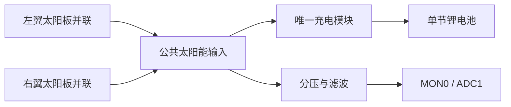

# 卫星 APP 使用说明

卫星应用现已组合三路舵机、Wi-Fi 信号采样、太阳能/电池电压与功率采样、角度寻优、供电与姿态策略，以及可选灯光、风扇和串口继电器。通用配置的硬件引脚默认为 `-1`（未配置）；XIAO ESP32S3 Sense 的天线轴默认 GPIO1。普通 ESP32_DEVKIT 当前启用左太阳翼 GPIO25、右太阳翼 GPIO26，雷达/天线轴暂时禁用，其余引脚未配置。创建舵机时不输出角度指令；已配置太阳翼电压通道时，首次有效采样后自动扫描一次，未配置时等待用户操作。网页不是必选项，默认使用串口交互。

## 普通 ESP32 太阳翼网页控制

适用于当前 ESP32-WROOM-32 / CH340 核心开发板。2026-10-28起，当前接线分配为：

| 舵机信号线 | 开发板IO | 网页卡片 | 串口轴名 |
| --- | --- | --- | --- |
| 左太阳翼 | D25 / GPIO25 | 左太阳翼 | left |
| 右太阳翼 | D26 / GPIO26 | 右太阳翼 | right |
| 雷达/天线（暂时禁用） | 未分配（原D14不再输出PWM） | 通信天线（未配置） | antenna |

原版 ESP32 通过 UART0（GPIO1/3）提供串口控制和日志，端口示例为 `/dev/ttyUSB0`。

```bash
bash tools/idf.sh --app satellite --board ESP32_DEVKIT --modules web,servo build
bash tools/idf.sh --app satellite --board ESP32_DEVKIT --modules web,servo -p /dev/ttyUSB0 flash
bash tools/serial_log.sh --port /dev/ttyUSB0 --output logs/serial/esp32-satellite.log
```

烧录前先停止该端口的日志记录器。默认接线保存在 `apps/satellite/boards/ESP32_DEVKIT.defaults`，已有同组合 sdkconfig 需在 menuconfig 中确认天线GPIO为-1、左太阳翼为25、右太阳翼为26。左翼启用反向映射，右翼保留正向映射，以匹配对称安装；已有 sdkconfig 还需确认 `SAT_AXIS1_REVERSED=y`、`SAT_AXIS2_REVERSED=n`。保留了此前天线的反向标志，轴禁用期间不生效。

连接热点 **ESP32-Satellite**，密码 **esp32setup**，访问 `http://192.168.4.1/satellite/`。也可通过已连接路由器分配的IP访问`/satellite/`。在“左太阳翼”和“右太阳翼”卡片分别确认GPIO25、GPIO26，输入目标角度并点击唯一的“设置角度”按钮；还可使用相对旋转、记录初始位置和复位，不会自动循环。默认0–180°、50Hz、500–2500μs；这组脉宽应按实际舵机型号校准。上电时PWM停止，网页输入或拖动滑块后须点击按钮才执行。

手机出现“设备连接中断”或“连接中断 · 数据已过期”时，表示网页刷新失败，不等于MCU重启。先确认手机所连网络与访问地址对应：设备热点使用`http://192.168.4.1/`，路由器网络使用设备在该路由器上的IP。网页请求现使用`AbortController`配合定时器，兼容缺少`AbortSignal.timeout()`的手机浏览器；此前直接调用该接口会在发出请求前失败。首页现在也显示具体失败原因。超时会取消本次请求，后续轮询自动重试，不自动重发控制命令。

HTTP服务的收发等待各设为2秒，启用TCP保活并保留空闲连接回收，减少不完整请求或停止接收数据的客户端阻塞其他连接的时间。此超时针对单次底层收发，不是整个HTTP响应的总时限。2026-10-28实机对照中，另一客户端仅发送部分请求头时，状态请求由约4.8秒降为1.75秒；另一客户端停止接收页面时，状态请求由9秒内未返回降为约3.9秒，移除异常客户端后恢复约0.04–0.09秒。记录见`logs/serial/2026-10-28-http-stall-results.json`。这些测试确认了服务器存在阻塞路径，不能据此判定手机上每次中断都由相同原因引起。

此组合包含Wi-Fi、网页、舵机和卫星控制逻辑。未连接的传感器显示未配置，不生成遥测数据。两路GPIO各连接对应舵机的信号线，舵机按额定参数供电，并与开发板共地。串口统一设置示例：`sat axis left angle 90`、`sat axis right angle 90`。雷达/天线命令因轴未配置而被拒绝。

当前右翼为正向角度映射：0°→500µs、45°→1000µs、90°→1500µs、135°→2000µs、180°→2500µs。左翼反向：0°→2500µs、45°→2000µs、90°→1500µs、135°→1000µs、180°→500µs。下方保留此前MG90S天线（GPIO14、反向映射）的诊断记录；其中的`antenna`命令需重新启用该轴后才可执行，也可按实际测试目的改用`left`或`right`。

两路实物均为MG90S。网页只保留一个“设置角度”按钮，使用应用的`angle`操作：初次指令、显式停止或错误恢复时直接建立角度；已有指令或自动关闭后，内部用500ms轨迹调整到新角度。目标脉宽保持1000ms后自动关闭，信号最终拉低。网页不再提供两种移动方式或时间输入框。自动关闭后网页显示“PWM已自动关闭”，保留指令角度并允许继续平滑/相对移动、记录位置与复位。显式“停止PWM”后也可点击同一个“设置角度”按钮恢复。该逻辑在舵机组件内运行，不依赖网页；可在`Satellite hardware and policies → Release servo PWM after idle target hold`配置保持时间，设0恢复持续输出。关闭后不保证保持力矩，计时也不能替代机械到位反馈。

两侧对称安装，ESP32_DEVKIT 配置将左翼 `SAT_AXIS1_REVERSED=y`、右翼 `SAT_AXIS2_REVERSED=n`。网页和串口继续使用逻辑角度：同样设置45°时，左翼输出2000µs、右翼输出1000µs；同样设置135°时，左翼输出1000µs、右翼输出2000µs。90°均为1500µs。反向映射在舵机组件内完成，相对旋转、初始位置和复位共用同一坐标。

镜像固件烧录后的真实网页检查：两路各点击45°、135°、90°，六次命令均返回成功，串口读回上述目标脉宽并采样到引脚上升沿；每次均自动关闭PWM，最终两路60ms采样均为低电平。记录见`logs/serial/2026-10-28-mirrored-wings-browser-results.json`；实际机械方向仍由装配观察确认。

2026-10-28无动作排查补充：用户确认当时舵机电源未与ESP32共地，重新接地后，D25/D26独立LEDC双路45°/135°测试已能转动。此前即使ESP32引脚采样有脉冲，也不足以证明舵机插头处信号参考和供电正确；本次不能将无动作归因于自动关闭PWM。

2026-10-28实机检查：旧固件在两路同时输出90°时，RMT在GPIO25/26均捕获1500µs高脉冲、20000µs周期，短时采样未见脉宽乱跳；原实现确实会在动作结束后持续输出。新固件验证了双路直接设置90°、平滑110°/70°、相对移动至100°/80°及复位90°/90°，每阶段均能自动关闭PWM。最终两路输入采样60ms均为低电平、上升沿0；这些检查不测量舵机供电幅值或机械角度，因此尚不能认定已找到无规律转动的硬件根因。结果保存在`logs/serial/2026-10-28-auto-release-hardware-results.json`和串口日志中。

### 0.5秒移动与卡顿排查

网页统一使用“设置角度”，已有角度时由应用内部安排500ms轨迹；低层HTTP/串口`set`和`move`仍为诊断保留。串口`move/by/home`默认使用500ms，可显式指定时长。50Hz PWM由硬件持续输出，页面状态轮询不会逐帧驱动舵机。

可从串口测量设备端命令与硬件PWM的时序：

```text
sat axis antenna set 45
sat timing antenna set 135
sat axis antenna set 45
sat timing antenna move 135 500
```

`sat timing`在真实控制路径执行指令，先将采样存入内存，再打印记录，避免UART打印影响时序。原版ESP32使用MCPWM，记录`source=command`的比较器指令值；ESP32-S3的LEDC记录`source=hardware`的占空比读回。直接设置观察100ms，平滑移动观察指定时长加100ms，诊断时长限1–2000ms。它不测网络等待或机械轴位置。500ms轨迹结束不等于机械轴一定在500ms内到位，实际情况取决于供电、负载与舵机性能。

此前原版ESP32的LEDC内存采样确认：500ms平滑移动只有约13档、约40ms一档，约530ms读到目标；直接设置约11ms就读到目标。SDK的原版ESP32 `ledc_ll_set_duty_start`会等待上一次更新完成。当前该芯片的舵机后端改为1MHz MCPWM，比较值在周期边界更新，避免运动任务受此LEDC等待影响。ESP32-S3保留原后端。

2026-10-27实机复测MCPWM：45°→135°的500ms轨迹记录到27个不同的比较器指令值，间隔最多20ms，约512.8ms下发最终1000µs指令；直接设置调用约97µs返回。该记录来自`source=command`，不表示硬件输出边沿或机械到位时间。另用引脚采样验证停止后无上升沿、恢复90°后60ms内3个上升沿，粗略周期约20ms。该轮固件使用GPIO14、反向天线配置和默认500ms平滑时间。

#### 第一次顺滑、第二次变慢的对照

先使用相同行程排除速度需求不同的影响。一次网页记录为90°→146°、146°→33.4°，都设500ms，但第二次行程约为第一次的两倍。独立四次60°/120°交替测试中，比较器指令均约498ms到达目标，未复现第二次软件轨迹变慢。

新增RMT硬件采样，直接观察GPIO输入缓冲器上的脉冲，而不只看MCPWM指令缓存：

```text
sat axis antenna set 60
sat capturepair antenna 120 500
sat axis antenna set 120
sat capturepair antenna 60 500
```

`capturepair`先移到指定角度，等待该次500ms轨迹及250ms保持后，再返回调用前的起始指令角度，两次运动之间保持PWM连续。使用128个RMT符号、1MHz分辨率，整次对照结束后才短暂停PWM以产生接收结束标记，并立即恢复最终角度。最后一条高脉冲可能被这一主动暂停截短，不作为运动异常分析。普通网页操作不触发此暂停。单次`capture`的参数格式同`timing`，抓取后也会执行这一收尾；两种抓取命令的轨迹时长上限1000ms。

RMT时间轴从首个捕获边沿开始，与CPU命令时间存在最多约一帧（20ms）的相位差，不能把两者直接相减当作微秒级命令延迟。2026-10-27实测：

| 连续动作 | 第一段到目标脉宽的近似时间 | 第二段到目标脉宽的近似时间 | 有效采样周期 |
| --- | --- | --- | --- |
| 60°→120°→60° | 约500ms | 约512ms | 全部20000µs |
| 120°→60°→120° | 约500ms | 约491ms | 全部20000µs |

对应高电平在约1833µs与1167µs间平滑变化。本次采样未见第二段PWM减速或丢脉冲；这不代表轴已经按时到位，也未测量舵机插头端的电压幅值。继续观察异常是否跟固定旋转方向、是否带负载、是否需要重新通电才能恢复等条件相关，再区分机械阻力、舵机内部与供电/接线问题。

当前用户反馈：MG90S用外部5V电源，最大800mA，已与ESP32共地。如果800mA是供电限流上限，应观察大角度直接跳转时是否限流，以及舵机插头红线对棕线的带载电压是否跌落；突然给定目标可能比平滑轨迹带来更高的启动电流，符合“直接反而慢”的一种可能解释，仍需实测确认。

建议用稳定5V、2A或以上电源作对照，使用短、可靠的供电接线并共地，先在45°–135°范围空载测试。可在舵机电源入口并联470–1000µF、额定耐压至少10V的电解电容，正极接5V、负极接GND，缓解短时波动；持续限流仍须解决电源容量或机械负载。[Adafruit舵机供电建议](https://learn.adafruit.com/adafruit-16-channel-pwm-servo-hat-for-raspberry-pi/powering-servos)、[启动电流与电容说明](https://learn.adafruit.com/adafruit-arduino-lesson-14-servo-motors/if-the-servo-misbehaves)。

[TowerPro MG90S标称速度](https://torqpro.com/product/mg90s/)为4.8V下0.10秒/60°，可作为性能参考；具体负载下能否达到0.5秒应实测，不能用软件状态代替角度反馈。

### 新增两份PDF的参数复核

读取了[MG90S资料（3页）](<mg90s/MG90S舵机..0).pdf>)和[SG90资料（2页）](<mg90s/SG90舵机 (2).pdf>)。前者为扫描图，封面正文写的是`Specification of GX90S`，末页配图标MG90S；不应仅凭文件名认定与手上舵机完全同一规格。

| 参数 | MG90S文件正文 | SG90文件正文 |
| --- | --- | --- |
| 电压 | 4.8–6.0V（第1页） | 4.8V（第1页） |
| 空载速度 | 4.8V：0.11秒/60°；6.0V：0.09秒/60° | 0.09秒/60° |
| 空载电流 | 4.8V：120±10mA；6.0V：180mA但公差缺失 | 90mA |
| 堵转电流 | 第2页原文`1±30mA`、`1.0±30mA`，单位/排版有误，须确认 | 750mA±10%，上限825mA |
| 控制行程 | 180° | 180°±3°（500–2500µs） |
| 中位/死区 | 1500µs / 4µs | 1500µs / 5µs |
| 旋转方向 | 顺时针（500–2500µs） | 逆时针（1000–2000µs） |

按MG文件4.8V空载速度线性估算，90°约0.165秒、180°约0.33秒；这些估算未包含完整加减速、稳定时间和负载影响，0.5秒可作空载测试目标，不能保证带负载同样到位。

文档存在以下矛盾：MG文件型号GX90S与配图MG90S不同，放大器类型中文写“数字控制器”但英文写“Analog controller”，花键正文11T而末页照片写21齿；SG文件5.3写500–1500µs，而5.5写500–2500µs对应180°。目前保留与原始使用说明和例程一致的500–2500µs配置，端点仍需按实物校准。两文件的“机构极限360°”不代表可控360°或连续旋转，它们的工作行程均另写180°。

MG堵转行疑似想表达约1A量级，但这只是推测，不能作为确定额定电流。800mA电源对SG资料的825mA堵转上限已没有完整余量，对当前MG则须通过启动/受载电流和带载电压确认。不能因为空载平均仅120mA就忽略启动瞬态，也不能因此断言800mA在所有情况下都不足。

两PDF均未给出PWM输入高电平门限或允许的刷新频率上限，因此不能据此认定必须5V信号，或直接提高到200/333Hz。当前仍以已有例程验证的50Hz工作，先解决更新时序、供电及负载问题。

### 网页、串口与周期测试的差异

| 项目 | 独立周期测试 | 卫星网页/串口控制 |
| --- | --- | --- |
| 命令入口 | 按配置周期切换目标角度 | HTTP或串口均调用`satellite_axis_command`，再调用同一个舵机组件 |
| PWM更新 | `ledc_set_duty`、`ledc_update_duty` | 相同两个API；硬件持续输出，设定一次后保持目标脉宽 |
| PWM时基 | 50Hz、14位LEDC、500–2500µs | 原版ESP32为50Hz、1µs分辨率MCPWM；ESP32-S3为14位LEDC |
| GPIO初始化 | 复位引脚、关闭上下拉、开启输入采样，再交给硬件PWM | 相同的确定性初始化；此前GPIO13保留了下拉、GPIO14保留了上拉 |
| 资源 | LEDC定时器1，SG90通道1、MG90S通道2 | 当时的天线GPIO14使用MCPWM动态分配的定时器/操作器，不占LEDC通道 |
| 后台功能 | 不启动Wi-Fi和网页 | 启动Wi-Fi、HTTP及状态轮询，启用运动与测量策略 |

2026-10-27的串口日志确认：网页提交的125.7°/132.2°到达MCU并返回ESP_OK，随后硬件读回分别为1554/16384和1613/16384，约1896.97µs和1968.99µs。用户随后确认本轮舵机无动作是忘记给舵机通电。GPIO初始化统一用于消除软件差异，不应将其记录为本次无动作的根因；排查时应确认舵机实际供电并共地。

网页命令日志追加了GPIO号和轴名。复查时可将`Command axis=... gpio=... role=...`与随后`sat pwm`的频率、占空比和引脚采样对应起来。当前串口直接控制示例：`sat axis antenna set 45`、`sat axis antenna set 135`。

## XIAO GPIO1 舵机网页验证

舵机信号线接 **D0 / GPIO1**，在网页中对应“通信天线”卡片。XIAO 卫星默认接线保存在 `apps/satellite/boards/XIAO_ESP32_S3_SENSE.defaults`，仅作用于该应用和板卡，不修改通用舵机组件或其他板卡。

只验证舵机和网页时使用以下组合：

```bash
bash tools/idf.sh --app satellite --board XIAO_ESP32_S3_SENSE --modules web,servo build
bash tools/idf.sh --app satellite --board XIAO_ESP32_S3_SENSE --modules web,servo -p /dev/ttyACM0 flash
```

需要同时保留录像和拍照时，将两条命令中的模块组合都改为 `--modules web,recording,servo`，`recording` 自动带入摄像头和存储。已有其他模块组合可继续使用，但必须包含 `web,servo`。

**已有构建目录的 sdkconfig 优先于默认接线。** 如果该组合以前将天线 GPIO 设为 `-1`，先使用相同的应用、板卡和模块参数运行 `menuconfig`，在 **Satellite hardware and policies → Antenna → PWM GPIO** 中设置为 `1`。默认校准范围为 0–180°、50 Hz、500–2500 μs，最大角度与脉宽可在该菜单按舵机型号修改。

1. 连接设备 Wi-Fi `ESP32-Satellite`，密码 `esp32setup`，打开 `http://192.168.4.1/satellite/`。
2. 确认“通信天线”卡片显示 **GPIO1**、状态为 **PWM 已停止**。输入 `90`，点击 **设置角度**。首次操作会建立角度指令，也可直接输入其他范围内的角度。
3. 再输入 `60`，仍点击 **设置角度**，验证后续调整和自动关闭。也可设置正负相对角度、记录初始位置及复位。
4. 点击 **停止 PWM** 结束输出；再次操作时先点击 **设置角度**。打开页面、拖动滑块和刷新页面都不会自动发送动作。

角度仪表显示指令值，不是实际角度反馈。GPIO1 只接信号线，舵机使用符合其额定电压和电流的电源，并与开发板共地。没有角度反馈时，首次位置未知，首次直接设置不能保证机械移动速度。

## 配置与启动

```bash
bash tools/idf.sh --app satellite menuconfig
bash tools/idf.sh --app satellite build
bash tools/idf.sh --app satellite -p /dev/ttyACM0 flash monitor
```

默认板卡为 YD ESP32-S3。XIAO 可在所有命令中加 `--board XIAO_ESP32_S3_SENSE`，但须重新确认引出脚和资源占用。所有接线在 **Satellite hardware and policies** 中配置；STA 连接参数在 **Component config → Network configuration** 中配置。

ESP32-S3 的新构建默认使用原生 USB Serial/JTAG 主控制台，普通 ESP32 使用 UART0，可以直接输入命令。以前生成的 sdkconfig 会保留已有选择，需按板卡在 menuconfig 的 ESP System Settings 中确认主控制台。仅作为辅助输出的 USB 接口不提供 UART0 的交互输入。

不带网络、网页的组合：

```bash
bash tools/idf.sh --app satellite --modules servo,voltage_sensor menuconfig
bash tools/idf.sh --app satellite --modules servo,voltage_sensor build
```

只要软件基座和串口，可用 `--modules ""`。默认选择 `network,servo,voltage_sensor,mpu6050,ws2812,fan,relay_uart`，卫星 APP 另外依赖无硬件副作用的 `angle_search` 与 `power_monitor` 算法组件。编译、配置、烧录须使用相同的模块组合。

## 硬件配置

| 功能 | 配置 | 说明 |
| --- | --- | --- |
| 天线、左太阳翼、右太阳翼 | 各自GPIO、最大校准角度、最小/最大脉宽、反向 | 原版ESP32动态分配50Hz MCPWM；ESP32-S3共用14位LEDC timer1，通道1/2/3；创建时无角度输出 |
| 左翼、右翼、电池、外部供电电压 | 各通道 ADC1 GPIO、上下分压电阻 | ADC1 多通道共用一个采样单元，校准后平均16次；上电后每秒采样 |
| 各路电流 | 模拟电流传感器输出 GPIO、分压比、零电流输出 mV、灵敏度 mV/A | 未接电流传感器时只提供电压，不伪造功率 |
| MPU6050 | SDA/SCL、I²C控制器、安装后的重力方向、倾斜及冲击阈值 | 六轴、芯片温度、倾斜状态；目前仍独占该 I²C 总线 |
| WS2812 | 数据 GPIO、灯珠数 | 低亮度状态灯；不驱动舵机 |
| 风扇 | PWM GPIO、可选测速 GPIO | timer2/channel4，25kHz，默认PPR=2；串口设置占空比并查看RPM |
| 继电器 | UART1 TX/RX、RTS、地址、通道数、起始线圈、波特率 | 当前卫星适配使用 Modbus RTU 8N1；底层驱动另外支持固定帧 |

所有 GPIO 均指芯片编号，不是排针编号。ADC1 通道只能选实际支持 ADC1 且未被其他功能占用的引脚；分压按最大可能开路电压设计，包含串联总电压和余量，不能把 ADC 的量程当成 3.3V 电源电压。电路共地、断电时反向供电保护及输入滤波需按实际硬件处理。分压值只是配置默认值，不代表适合所有太阳能板。

`voltage_sensor` 通过 ESP-IDF 的曲线校准将原始值换算为 mV，再按分压比还原。超过 ADC 上端有效范围的饱和读数报错；校准不可用时初始化失败，不用猜测值替代。组件 API 还提供 gain/offset 校正参数，参考万用表测量后由具体产品配置。

模拟电流计算：`电流 A = (还原后的传感器输出 mV − 零点 mV) / 灵敏度 mV/A`。这是供模拟输出电流传感器使用的接口，不是直接把电流接入 GPIO。INA219/INA226 等数字传感器驱动尚未新增，后续可将其真实电压/电流样本接入独立的 `power_monitor`，不需要改动寻优算法。

## 串口命令

### 日志保存与回溯

服务器可直接将串口输出追加到文件，每行包含服务器时间，拔插 MCU 后自动重连。记录器不发送舵机命令。网页控制请求也会输出轴、动作、角度、移动时间和返回码，便于关联设置失败的原因。

```bash
bash tools/serial_log.sh --port /dev/ttyACM0 --output logs/serial/satellite.log
```

前台按 `Ctrl+C` 停止。长期记录可在后台运行：

```bash
mkdir -p logs/serial
nohup bash tools/serial_log.sh --port /dev/ttyACM0 --output logs/serial/satellite.log > logs/serial/logger.out 2>&1 &
tail -f logs/serial/satellite.log
```

日志以追加方式写入，重新启动不会覆盖之前内容；`logs/` 已由 Git 忽略。PID 写入 `logs/serial/satellite.pid`，使用 `kill -- "$(cat logs/serial/satellite.pid)"` 停止。烧录或启动交互式 monitor 前先停止记录器，操作结束后重新启动，避免争用串口。需要固定设备时，将 `--port` 换成 `/dev/serial/by-id/` 下对应的完整路径。

输入 `sat help` 查看命令。轴名：`antenna`、`left`、`right`。

```text
sat status
sat pwm
sat axis antenna set 60
sat axis antenna record
sat axis antenna by 30 1000
sat axis antenna move 45 1500
sat axis antenna home
sat axis antenna limit 150
sat axis antenna hold
sat axis antenna stop
sat axis left set 60
sat axis right set 60
sat axis left auto
sat axis right auto
sat axis antenna scan
sat trace antenna
sat axis antenna auto
sat axis antenna manual
sat axis antenna demo
sat fan 40
sat led 24
sat relay 0 1
sat standby
sat resume
```

- `angle`为网页使用的统一角度操作，无需选择移动方式；首次或显式停止后直接建立角度，其余由应用内部执行500ms轨迹。
- `set` 直接设置绝对角度，也用于建立起始指令；首次机械位置未知，不能承诺初始移动平滑。`move/by` 默认移动500ms，可在值后指定时长。
- `record` 记录已建立且空闲的指令位置；`home` 默认以500ms轨迹返回。初始位置及运行时限位不跨重启保存。
- `limit` 设置0到指定角度的软件范围，不改变创建时的角度到脉宽映射；当前指令及初始位置须在新范围内，且轨迹必须空闲。
- `hold` 取消运动并保持最新PWM；`stop` 停止PWM。停止后必须重新 `set` 才能平滑移动。
- `scan` 执行一次粗扫/细扫，返回选定位置后结束；`auto` 对天线执行一轮后进入弱信号触发监测，对太阳翼执行一轮后进入低压触发监测。`sat trace antenna|left|right` 导出最新一次扫描的角度和采样均值（CSV，天线为dBm、太阳翼为V），可用于绘制曲线，最多保留256个点。
- `manual` 取消该轴自动任务并保持位置。手动移动请求会取得该轴控制权，不会被后台寻优再次覆盖。
- `demo` 在该轴允许范围内重复平滑往返；须先 `set`，可以通过 `hold/stop/manual` 取消。
- `standby` 停止三路PWM、设风扇0%并熄灯，继电器保持状态。`resume` 只解除待机，不自动恢复之前的动作。
- 风扇0%不等于断电，取消舵机运动并保持PWM也不等于切断供电。继电器通道用途未知，因此不自动切换电源支路。

状态显示的舵机位置是指令值，不是物理反馈。±1° 仍是待实物校准和验证的目标。

`sat pwm`不改变角度：打印PWM后端、频率、比较值、周期与换算脉宽。MCPWM行标记`PWM command`，表示最后成功下发的比较器指令；LEDC行标记`PWM hardware`，表示硬件占空比读回。两者随后均输出GPIO使能/开漏/复用配置；输入缓冲器开启时，以约200µs间隔采样60ms，报告实际引脚高低样本、上升沿数及粗略周期。它不会自动切换引脚模式，输出会保存到串口日志。这些数据不能替代实际引脚电压和机械角度测量。

## Wi-Fi 采样与天线寻优

默认 AP 为 `ESP32-Satellite`，密码 `esp32setup`。填写 `MCU_WIFI_STA_SSID/PASSWORD` 后使用 AP+STA 模式；不填则保持 AP 模式，RSSI 标为不可用。STA 自动连接，断线后按1秒至60秒退避重连。凭据目前通过 menuconfig 写入固件，不提供运行时配网流程；不要提交包含私有凭据的 sdkconfig。

当前卫星部署连接`dongfangtiansuan`时使用固定地址 **192.168.30.187**，子网掩码`255.255.255.0`，网关和DNS均为`192.168.30.1`；网关与掩码已从开发板原DHCP连接日志核对。访问地址为`http://192.168.30.187/satellite/`。网络组件在启动STA之前停止DHCP客户端并设置IPv4和DNS，ESP32自身AP仍保留`192.168.4.1`。配置存于`apps/satellite/network.defaults`（不包含私有密码），只有STA SSID匹配`MCU_WIFI_STA_STATIC_SSID`才应用；换用其他SSID时继续使用DHCP。菜单路径为`Network configuration → Use a static station IPv4 address`。已有sdkconfig需确认对应选项值，`GET /api/status`的`sta_ip/sta_netmask/sta_gateway/sta_static_ip`来自实际网络接口，其中`sta_static_ip`检查DHCP客户端是否已停止。参见[Espressif静态IPv4配置说明](https://docs.espressif.com/projects/esp-idf/en/stable/esp32/api-reference/network/esp_netif_programming.html)。

网页的通信天线、左右太阳翼卡片均提供显式的 **手动控制 / 自动控制** 按钮，选中状态来自设备遥测。手动模式可以直接输入角度、点击“设置角度”验证PWM；不要求Wi-Fi RSSI或太阳能电压有效。进入自动模式后锁定手动角度输入，点击“手动控制”取消扫描后即可调整；“停止PWM”也会退出自动模式。左右翼共用自动模式，点击任一翼的模式按钮同时切换两翼；天线模式独立。单次扫描保留在折叠的测试入口，串口/C API也仍可使用。模式存于运行内存，刷新页面不会改变模式；重启后按固件启动策略恢复（天线手动，太阳翼由`SAT_SOLAR_BOOT_SCAN`决定）。

Wi-Fi每秒使用网络组件`wifi_manager_get_signal()`读取已关联路由器的RSSI、SSID、BSSID、信道和采样时间；网页顶部显示具体RSSI（dBm），并显示最近最多5次读取的平均值、最小值和最大值。断线或换AP时重置窗口，采样失效显示“—”。这是ESP32作为STA接收路由器的信号，手机连接ESP32热点本身不能提供这个测量。实现依据[Espressif关联AP信息接口](https://docs.espressif.com/projects/esp-idf/en/latest/esp32/api-reference/network/esp_wifi.html#_CPPv424esp_wifi_sta_get_ap_infoP16wifi_ap_record_t)。读取时间不等同于每个无线数据包的接收时间。

已配置天线舵机且RSSI有效时，可以直接开启自动控制，无需先设起始角度。算法按10°粗扫、最佳位置附近2°细扫；每点用1000ms轨迹移动（首次未知位置直接建立角度指令），默认等待500ms，再收集3次不同读取时刻的RSSI求均值，选取最大的均值并返回对应角度。每点单独累计，显示用的5点窗口不参与角度打分，以免混合不同角度的数据。RSSI负值越接近0表示越强；天线卡片显示本次扫描最强信号及对应指令角度，曲线与CSV保留各测量点。

完成扫描后监测信号，不按固定周期反复扫描。默认连续3次RSSI低于 **-75 dBm** 才触发下一轮；从上轮结束起至少等待300秒，同一段持续弱信号只触发一次，恢复至 **-65 dBm** 后重新允许弱信号触发。分别配置`SAT_ANTENNA_LOW_DBM`、`SAT_ANTENNA_RECOVER_DBM`、`SAT_AUTO_INTERVAL_S`。切到自动模式会立即执行首轮，切回手动后不再自动触发；重新连接不会自行恢复已取消的自动模式。

每次扫描锁定当前BSSID。断线、AP变化、采样超过3秒未更新，或触发待机/低电量/姿态保护，都会取消自动控制；重复开启正在运行的扫描会被拒绝。完成目标后遵循舵机组件的PWM自动释放策略，角度是指令值，不是机械反馈。上述业务在卫星任务中运行，不依赖网页：`sat axis antenna angle 90`、`sat axis antenna auto`、`sat axis antenna manual`、`sat axis antenna stop`、`sat status`可从串口操作；C调用统一使用`satellite_axis_command()`和`satellite_get_status()`。

ESP32_DEVKIT天线GPIO当前仍为`-1`，保留此前禁用天线输出的接线配置，D25/D26仍给左右太阳翼。确认新天线接线后，在`Satellite hardware and policies → Antenna → PWM GPIO`设置引脚再重新编译烧录。GPIO14可沿用此前接线，切勿占用两翼引脚。即使天线PWM禁用，Wi-Fi信号监测仍正常工作。

必须转动实际连接的天线；装饰雷达盘转动不会自动改变固定天线的方向。RSSI不等于吞吐率或射频测向结果，实际天线、环境波动和馈线限位需要上机验证。自动调整只是在本次离散扫描样本中选择较强信号，不能保证长期或全局最优。

2026-10-28验证：15项本机业务/算法测试、15项浏览器测试通过；带网页、不带网页（network/servo/voltage_sensor）和仅servo三种ESP32配置均编译通过。当前板已烧录并通过HTTP核实STA固定IP为192.168.30.187且DHCP客户端停止，实时RSSI可读，网页资源与本地版本一致。此配置天线GPIO和公共电压ADC仍为-1，上电后三路PWM均关闭；未验证天线实际调向效果和太阳能实测扫描结果。串口日志持续保存至`logs/serial/esp32-satellite.log`。

## 太阳能寻优与能量统计

当前硬件计划为6块5.5V/80mA太阳板全部并联，共用一个充电模块。所有正极汇接、所有负极汇接后，左右翼是同一个电压节点，只需在充电模块的太阳能输入端设置一组分压采样。模块5V稳压输出不用于角度寻优。图片资料见[太阳板](太阳能板.jpg)和[充电模块](充电模块.png)：模块标注输入4.5–6V，太阳板未提供最高开路电压，接入前仍需核实输入不会超过模块允许范围。



软件每秒采样公共电压，启动一轮双翼寻优后先固定右翼、以10°粗扫和2°细扫左翼，左翼回到本阶段最佳角度后，再固定左翼扫描右翼。每点移动结束等待500ms，比较3个新鲜电压样本的平均值。两翼不会同时执行搜索运动。这里“固定”表示不再给另一翼下发运动指令；PWM仍按原策略释放，实际位置需由机构保持。

网页任一翼的“**双翼低压自动寻优**”或 `sat axis left auto` / `sat axis right auto` 都启动同一个先左后右流程。每翼的“电压扫描”或 `scan` 仍只扫描选中的一翼。已有扫描时拒绝第二个扫描请求；手动设置任一翼角度、取消、停止或进入待机会取消两翼自动流程及排队任务，避免在比较期间改变另一翼位置。显式“停止PWM”会停止两路输出。

默认开机后等待公共输入首次有效采样，扫描左右翼各一次；之后只监测电压。连续3个新样本低于4.0V才再次触发整轮扫描，且距上一轮完成至少300秒。持续低压只触发一次，须恢复到4.5V或以上才允许下一次低压触发。冷却计时从**右翼完成**后开始，不会单独重扫左翼。`SAT_SOLAR_BOOT_SCAN`、`SAT_SOLAR_LOW_MV`、`SAT_SOLAR_RECOVER_MV`、`SAT_SOLAR_COOLDOWN_S`可配置这些策略；默认阈值需按实际太阳板和采样点调整。

两翼共用 `SAT_MON0_V_GPIO`、`SAT_MON0_V_UPPER`、`SAT_MON0_V_LOWER`；MON1保留为辅助采样，不参与太阳翼寻优。普通ESP32可选ADC1引脚（例如空闲的GPIO34），输入有效性由驱动校验；未接线时GPIO保持-1。上臂30kΩ、下臂10kΩ和ADC对地100nF滤波电容为当前分压方案，仍须核对最高开路电压。电流采样可一直禁用。

构建命令：`bash tools/idf.sh --app satellite --board ESP32_DEVKIT --modules web,servo,voltage_sensor build`。控制逻辑在卫星应用核心中，网页和串口共用同一接口，移除网页模块也可运行。普通ESP32使用ADC线性校准，S3使用曲线校准。

网页显示公共输入电压、当前扫描翼及各翼扫描阶段的公共电压峰值和对应角度。API的 `solar_active_axis` 为0/1/2（空闲/左翼/右翼），`solar_pending_right`表示右翼等待，`solar_voltage_channel=0`表示共用MON0。两个扫描峰值对应**不同的另一翼固定位置**，不能解释为两翼各自的发电电压或相加。曲线与峰值保存在内存中，开始新一轮重置，重启清除。

采样异常、过期、运动错误或每点15秒超时会取消整轮流程，故障恢复后需显式重新启动。分轴顺序搜索不保证得到二维全局最优角度；充电模块和光照变化也会影响公共电压。当前目标是公共输入电压最大，不据此宣称充电功率最大。

该算法优化机械角度，不实现充电电路的MPPT。初始全范围扫描主要用于硬件验证，后续应按实测发电增益、舵机耗电和机构范围优化步长、扫描范围与周期。

能量使用梯形积分累计为本次运行的Wh；丢样或间隔超过3秒时中断积分，恢复后重新建立积分起点，不把空白时段假设成持续发电。电流为有符号值，因此电池测量可表示净充入/放出能量；这不是精确剩余电量，也不跨重启保存。

## 供电与姿态策略

- 配置电池采样后，电压未知/读数失败会阻止新的轴动作，并取消正在执行的动作；未配置电池检测时标为未配置，不宣称有电池保护。
- 默认低电量阈值3.3V、恢复阈值3.6V，只是单节锂电应用的初始参数，必须按实际电池、供电和负载调整。低电量时取消动作、拒绝新动作、降低状态灯亮度。
- MPU6050 每秒采样，按配置的重力方向计算倾斜；连续3次超限或采样时检测到大加速度触发姿态异常。传感器失效也阻止动作。动态加速度会影响倾角估算，这不是高频防碰撞或精密姿态系统。
- 状态灯：红色表示姿态/供电数据异常，橙色表示低电量，绿色表示STA连接，蓝色表示其余运行状态，待机熄灯。亮度可用 `sat led` 调整。
- 风扇目前由命令直接调速，不将MPU6050芯片温度当作机壳或电池温度来自动控制散热。

## 可选 HTTP 接口

选择 `web` 才编译 HTTP 适配，`web` 自动带入 `network`，核心组件不依赖它们：

```bash
bash tools/idf.sh --app satellite --modules web,servo,voltage_sensor,mpu6050,ws2812,fan,relay_uart build
```

- `GET /api/satellite/scan?axis=0`：最新扫描曲线，points内每项为 `[角度, 测量均值]`。
- `GET /api/satellite/status`：轴、供电、RSSI、姿态及外设状态，轴的 `gpio` 给出信号接线；`wifi_ssid/wifi_bssid/wifi_channel`标识链路，`rssi_dbm/rssi_mean_dbm/rssi_min_dbm/rssi_max_dbm`给出信号读数，`wifi_sample_us/wifi_samples/wifi_error`给出采样状态，天线轴的`best_rssi_dbm/best_angle`给出本次扫描结果；无有效测量或未配置 GPIO 的数值为 `null`。
- `POST /api/satellite/command?action=angle&axis=1&value=90`（统一设置角度）
- `POST /api/satellite/command?action=by&axis=0&value=30&duration_ms=1000`
- `POST /api/satellite/command?action=auto&axis=1`
- `POST /api/satellite/command?action=standby`
- `POST /api/satellite/command?action=relay&channel=0&value=1`

axis为0/1/2，对应天线/左翼/右翼。状态中的power数组依次为太阳能公共输入、辅助采样、电池、外部供电。数值动作必须携带value。错误参数返回400，未就绪/策略拒绝返回409，准备重启返回503。打开 `http://192.168.4.1/`，从首页进入“卫星控制台”，或直接访问 `/satellite/`。界面提供三路指令角度仪表、显式手动/自动模式切换、电源遥测、扫描曲线/CSV导出与辅助设备控制；所有按钮调用同一套业务API。未配置或失联时禁用控制，滑块只修改目标，点击按钮后才执行。样式和脚本全部内置，无需外部网络。

## 组件边界与验证

- `voltage_sensor`：GPIO资源保护、共享ADC1、校准和采样；不依赖网络或网页。
- `power_monitor`：接受测量数据，计算功率、能量、低电量迟滞；不负责获取传感器数据。
- `angle_search`：可确定性测试的有限状态机；接受新样本和运动状态，输出下一目标角度，不直接操作硬件，不创建任务。
- `apps/satellite/main/satellite.c`：组合硬件、采样、模式和策略，单控制任务与互斥锁统一仲裁所有入口。
- `satellite_console.c` / `satellite_web.c`：调用同一个业务API；网页适配可完全裁掉。

主机回归覆盖寻优收敛、无效/重复样本与超时、弱光、能量丢样处理、手动优先、初始位置记录条件、低电量与恢复、BSSID变更、待机，以及ADC共享与初始化失败清理。网页回归覆盖 GPIO1 首次角度设置、后续平滑移动及空值/越界拦截。固件编译和启动验证不等于舵机实际角度精度验证，机械到位及脉宽范围仍需按实际硬件校准。
